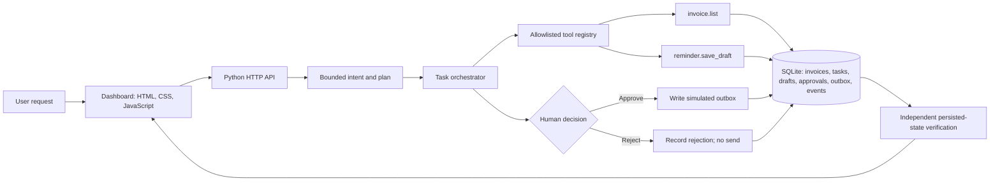

# CentrAlign AI Company Operator

A small, runnable AI employee prototype for one bounded business workflow: preparing and approving invoice follow-up reminders. The agent reads real SQLite rows, calculates eligibility and priority, saves personalized drafts, waits for a human decision before any simulated send, and re-reads persisted state to verify the result. It runs locally without a paid model API, external credentials, or Python package installation.

## Run it

Requirements: Python 3.10+ (the app uses only the Python standard library).

```powershell
python app.py
```

Open [http://127.0.0.1:8000](http://127.0.0.1:8000). The first start creates `centrAlign.sqlite3` and seeds seven fictional invoices. Use Ctrl+C to stop. The same database file is reused on restart. To use a different database path, set `CENTRALIGN_DB` before starting the server.

Run the automated verification suite in another terminal:

```powershell
python -m unittest -v
```

All external operations are local. Approved messages are written to the app's simulated outbox; the prototype does not send email.

## Architecture



The HTTP server, tool registry, orchestrator, approval manager, retry handling, and persistence are in `app.py`. The browser UI is served by that same local process from `index.html`, `styles.css`, and `app.js`. SQLite stores the invoice ledger, task state, task-to-invoice decisions, drafts, outbox, and timestamped events. There are no third-party backend packages, frontend build step, model framework, or external API integrations.

## Agent lifecycle

1. **Understand:** a small deterministic intent check accepts invoice, overdue, follow-up, reminder, or payment requests. Unsupported tasks are rejected with an explanation.
2. **Plan:** the service constructs a fixed, typed sequence for understanding, reading invoices, prioritizing, drafting, approval, and verification. User text is never interpreted as code or as tool names.
3. **Execute and observe:** the orchestrator calls `invoice.list`, calculates days overdue and outstanding balances from the SQLite records, excludes paid and not-yet-due invoices, then ranks eligible invoices by descending overdue age and amount. Invoices overdue by at least 21 days or with at least $6,000 outstanding are labeled high priority.
4. **Adapt:** each draft save has a two-attempt limit. A transient error is recorded in the audit timeline; one safe retry is attempted. The dashboard's “Arm one-time retry demo” control injects a single failure into the next draft write.
5. **Persist:** each draft ID is deterministically derived from its task and invoice. A unique `(task_id, invoice_id)` constraint and `INSERT OR IGNORE` prevent duplicate drafts during retries.
6. **Ask for approval:** each draft independently requires approval or rejection. Approving queues one message in the local outbox. Rejecting records the decision and never calls the queue operation. Decisions are immutable and duplicate approvals are rejected.
7. **Verify:** task details are rebuilt from database queries. The verification reports persisted draft, pending, approved, rejected, and outbox counts. It also compares the persisted draft invoice set with the eligible invoice set and checks that approved drafts correspond exactly to outbox entries.
8. **Report:** the UI shows the generated plan, tool names and outcomes, event timeline, draft status, simulated outbox, task status, and verification evidence.

## Tools and permissions

The registry contains two callable tools: `invoice.list` reads the invoice ledger, and `reminder.save_draft` persists one allowlisted reminder draft. The registry maps known names to typed Python callables; there is no arbitrary tool dispatch or generated code execution. The only protected operation is adding a previously approved draft to the simulated outbox. Approval is checked in the backend, and a rejected draft cannot be approved later because decisions are single-use.

## Model and fallback

This build uses a deterministic local agent. It does not call an LLM or claim model-generated plans or prose. Intent handling is deliberately narrow, the workflow plan is structured in code, and reminder text is generated from invoice fields. This keeps the demo reproducible and runnable offline. An LLM could later propose plans and draft language, but those proposals would need schema validation and tool allowlisting before execution.

## What is autonomous and what is configured

The system interprets a supported goal, selects and calls registered tools, calculates eligibility and ranking from actual invoice data, generates and persists drafts, observes write failures, retries within a fixed bound, pauses for approval, and verifies saved state independently. Human approval is required per message. No email is sent.

The supported workflow, intent keywords, priority thresholds, retry count, seed records, local database, and reminder template are configured in code. There is no cross-workflow planner, company policy memory, external connector, model, task queue, authentication, or deployment. Dates on seeded invoices are relative to the date the database is first initialized; an existing database retains those dates.

## Tests and actual results

`python -m unittest -v` covers invoice eligibility and calculations, priority ordering, approval enforcement, rejection safety, retry behavior and limits, duplicate prevention, database reconnection, and persistence from a fresh Python process. Latest run: **8 tests passed**. `node --check app.js` and Python byte-compilation also passed. The local API routes are `GET /api/state`, `POST /api/tasks`, `GET /api/tasks/{id}`, `POST /api/drafts/{id}/decision`, and `POST /api/failure-injection`.

## Demo walkthrough

See [DEMO_SCRIPT.md](DEMO_SCRIPT.md) for a concise recording plan. Recommended sequence: start the server, arm the retry injection, run the sample request, point out the observed retry and actual drafts, reject one draft and approve another, then show the verification counts and simulated outbox. Refresh the page to demonstrate persisted state.

## Known limits and next steps

This is a single-process local prototype, not a production employee. The intent check and plan are fixed; there is no model-based interpretation, authentication, authorization identity, concurrent task queue, company-specific policy store, time-zone handling, or external integration. The seed data is fictional and uses USD. Verification checks the persisted eligible set and approval/outbox consistency, but does not independently validate the semantic quality of email text. The server is intended for local demonstration only.

With two more weeks, I would add a typed workflow interface with policy-configured actions, an evaluation harness with failure and changing-state cases, stronger user/session authorization and audit identity, isolated task workers with durable locking, an LLM planning option behind strict schemas and the same tool allowlist, configurable company memory, and an opt-in sandbox connector with integration tests.

## Stack and disclosures

- Python standard library: `http.server`, `sqlite3`, `json`, `datetime`, `uuid`, and `unittest`.
- Frontend: browser-native HTML, CSS, and JavaScript; no package manager or framework.
- Storage/API: local SQLite and a small JSON-over-HTTP API.
- External models/APIs: none.
- AI coding tool: OpenAI Codex was used to inspect the supplied brief and create this implementation and documentation. Review and understand the code before submitting.
- Pre-built components: no application starter or third-party agent framework was added; this uses the Python standard library and browser-native components.

